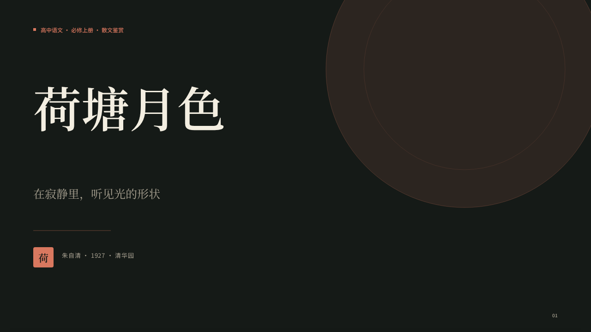
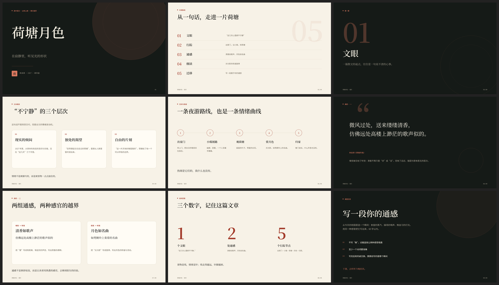
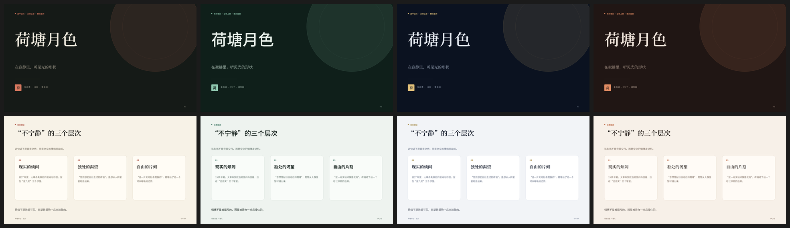
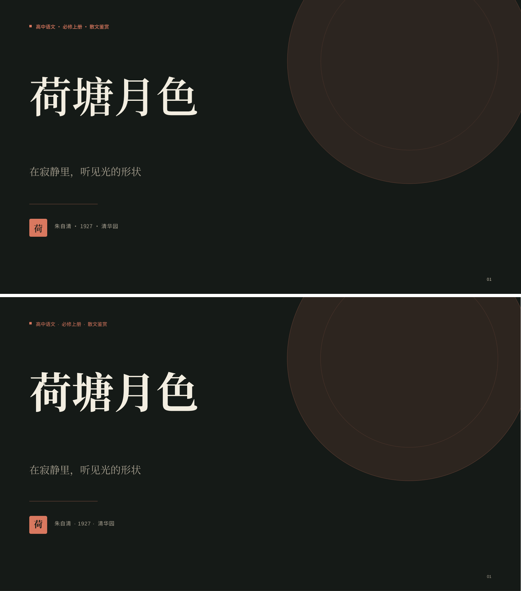
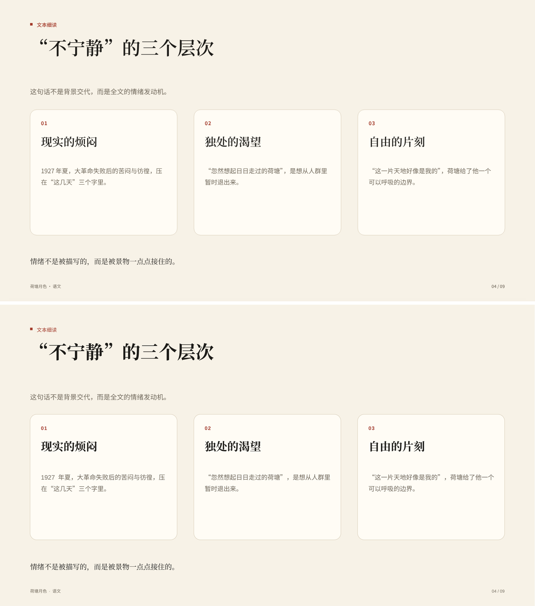
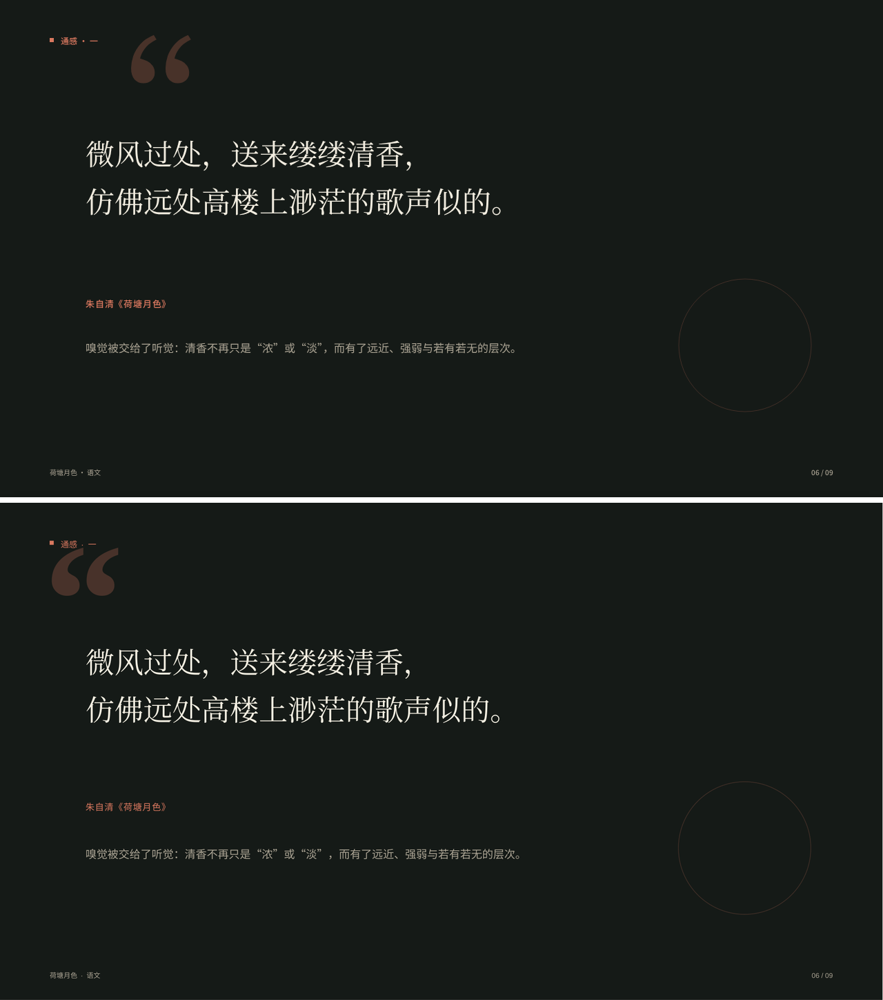

# Agent 生成 PPT：方案研究与落地建议

版本：研究稿 v1  
日期：2026-11-08  
范围：只做方案研究与可行性原型，未改动 `/agent` 的生产接口、数据模型和界面。  
配套证据：`docs/evidence/ppt-prototype/`（中文渲染链路验证）与 `docs/evidence/ppt-prototype-en/`（英语教学 v2）。

> **修订说明（2026-11-08）**：本稿早期用《荷塘月色》探索“同一 scene 双渲染”，项目实际是**英语教学**。英语课件的字号、密度、prompt/reveal、字体与设计时调优见 `docs/AGENT_PPT_TEACHING_DESIGN.md`；本文 §7 的中文主题、§9 的中文样例只作渲染链路参考，不代表最终英语设计。

## 0. 结论先行

**建议采用“设计系统 + 结构化 deck + 确定性编译 + 双渲染”的路线，而不是让模型自由写 HTML 再转 PPTX，也不是把内容填进固定的 PPTX 模板。**

一句话概括分工：

> 模型只负责“讲什么、按什么顺序讲、选哪种版式”；我们负责“长什么样”。

具体做法：

1. 定义一套受控的 deck JSON：每页只允许选版式（cover / points / compare / quote / process / stats / …），填写标题、正文、备注、来源，不写坐标、CSS、字号和颜色。
2. 后端用确定性编译器把 deck JSON 排成 1280×720 的场景图（scene）：文本先按真实字体度量断行，再算坐标、字号、行高和颜色。
3. 同一个 scene 有两个渲染器：
   - SVG：工作台预览、全屏放映、移动端适配；
   - python-pptx：导出原生 `.pptx`，文字是可编辑文本，形状是原生形状。
4. 主题是数据，不是提示词。换主题只换一组 token（背景、墨色、强调色、标题字体），内容不重新生成。

先用 9 页中文样例验证渲染链路，再为英语教学做了 v2 原型（11 页阅读 + 9 页续写 + 3 页语法/试题；见 `docs/AGENT_PPT_TEACHING_DESIGN.md`）。中文样例的指标：

- 9 页、4 套主题、9 种版式，全部无文本溢出；
- 编译 0.34 s、生成 SVG 0.15 s、生成 PPTX 0.42 s（本机）；
- PPTX 约 59 KB，9 页全部是原生文本/形状，没有整页截图；
- SVG 预览与 PPTX（LibreOffice 渲染）的逐页像素差：MAE 1.4–4.1 / 255，差异大于 40 的像素占 1.4%–3.4%，主要来自字体抗锯齿和少量基线差异；
- 详见 `docs/evidence/ppt-prototype/`。

这条路线的代价是“设计自由度”而不是“美观上限”：版式是我们预先设计的，模型不能临场发明布局。对教学课件来说，稳定、统一、可编辑比“每份都不一样”更重要；需要更强表现力时，可以后续增加版式、图表、图片和品牌模板，而不改变主链路。

在正式投入前，需要先确认三件事（见 §12）：

1. 交付物是否必须是 `.pptx`，还是“网页放映 + 可选导出”也能接受？
2. 是否第一天就要支持学校/机构自己的 PPT 模板？
3. 首版是否需要图表、表格和图片？

## 1. 需求拆解

“PPT 一定要美观”不是一个单点需求，至少要同时满足：

| 维度 | 具体要求 | 对方案的含义 |
| --- | --- | --- |
| 美观 | 版式有秩序、字体和配色统一、留白充分、不出现“AI 味” | 不能把审美完全交给模型；需要设计系统和版式约束 |
| 可编辑 | 教师能在 PowerPoint / WPS 里改字、换图、调位置 | 不能整页截图；文本和形状要原生 |
| 保真 | 网页预览与导出的 PPTX 看起来一致 | 预览和导出最好共享同一份布局结果 |
| 可控 | 内容来自材料，不编造；页数、字数、版式可约束 | 需要结构化输出和校验，不是自由文本 |
| 可版本化 | 每一稿可比较、可回退、可审阅 | 版本里要存语义稿和编译依据，不能只存二进制 |
| 性能 | 10 页左右在几秒内完成编译，移动端能看 | 不要把渲染放到请求链路的重活里 |
| 成本 | 一次生成不要烧掉过多 token | 模型只写内容，不写 CSS/坐标，输出量小 |
| 中文 | 中文断行、标点禁则、字体回退正确 | 需要中文排版规则和字体映射 |

其中“美观”和“可编辑”是最容易冲突的一对：越自由的 HTML/CSS 越容易好看，但越难无损转成可编辑的 PPTX；越原生的 PPTX 越容易编辑，但版式表达越受限。

## 2. 市面上的五条路线

市面上常被混在一起说的“HTML / skill / 模板”，其实是五个不同层面的东西。先按**交付物**分，而不是按“用不用 skill”分：

| 路线 | 典型代表 | 美观上限 | 可编辑性 | 主要问题 |
| --- | --- | --- | --- | --- |
| A. HTML 网页幻灯片 | frontend-slides、guizang-ppt-skill、html-ppt-skill；Claude Design 的社区观察 | 很高，CSS/动画/WebGL 都能用 | 网页内可改；导出 PPTX 困难 | 交付物是 HTML，不是 PPTX；转 PPTX 是另一个子系统 |
| B. 原生 PPTX 代码生成 | Anthropic 官方 pptx skill（pptxgenjs）、PPT Master（SVG→DrawingML）、GordenPPTSkill（python-pptx） | 中到高，取决于生成器和设计规范 | 高，文本/形状原生 | 生成器复杂；自由布局容易溢出/错位；需要 QA |
| C. 模板填充 | Beautiful.ai、Gamma 的卡片模板、GordenPPTSkill 的 17 套模板、Presenton 的自定义模板 | 高且稳定 | 高 | 版式有限、容易“千篇一律”；模板维护成本高 |
| D. 图片优先 | NanoBanana-PPT-Skills、gpt-image-2 相关 skill、ppt-image-first | 很高，接近海报 | 低，基本不可改 | 一页就是一张图；改字要重生成；文件和成本高 |
| E. 协议/操作层 | Office-PowerPoint-MCP、PPTAgent | 取决于模型操作能力 | 高 | 适合改已有 PPT；从零生成不稳定 |

### 2.1 A 路线：HTML 网页幻灯片

这是 2025–2026 年 Agent 圈最流行的路线。代表项目 `frontend-slides`、`guizang-ppt-skill`、`html-ppt-skill` 都是“给 Agent 一份 SKILL.md + 设计预设 + HTML 模板”，让模型直接生成单文件 HTML。优点是模型对 HTML/CSS 最熟悉，视觉表达自由，动画和响应式都容易做；缺点是交付物天然是网页，客户要 `.pptx` 时还得再转。

社区里有一个有代表性的观点（宝玉，2026-09）：AI 做 PPT 的最佳实践是“用 Design System 定义风格 + 用 HTML 生成网页 PPT + 导出可编辑 PPTX”，并认为 Kimi 的 PPTD DSL 表达力有限、训练不足；模板则限制模型发挥。[7][8]

这个观点有一半是对的：**设计系统 + 让模型在它最擅长的格式里工作**，确实比“让模型直接操作 PowerPoint”更容易出效果。但它没有回答“HTML 怎么稳定变成可编辑 PPTX”这个工程问题。我们在 §3.5 会看到，这个转换本身是一个几千行的子系统。

### 2.2 B 路线：原生 PPTX 代码生成

不经过 HTML，直接生成 OOXML/PPTX：

- Anthropic 官方 `pptx` skill 现在用 `pptxgenjs` 写 PPTX，再配合 OOXML 编辑和强制 QA。
- PPT Master 让模型生成受约束的 SVG，再编译成原生 DrawingML。
- GordenPPTSkill 用 17 套手工设计的中文 PPTX 模板 + python-pptx 做“非破坏性文本替换”。

这条路线的好处是交付物直接是 `.pptx`，文字和形状原生可编辑；难点是生成器要处理字体、行高、溢出、图表、母版、兼容性等一大堆细节，必须配 QA。

### 2.3 C 路线：模板填充

模板填充把“设计”固定在模板里，模型只填内容。Beautiful.ai 的 Smart Slides、Gamma 的卡片模板、GordenPPTSkill 的 17 套模板、Presenton 的自定义模板都属于这一类。

它的美观和稳定性最好，工程成本也最低；但版式数量有限，内容一多就要拆页或缩字号，容易出现“每份 PPT 都长得一样”的问题。对“学校有自己的模板、必须套用”的场景，模板填充反而是刚需。

### 2.4 D 路线：图片优先

把每一页先做成一张图，再放进 PPTX。视觉上限最高，适合封面、海报、宣传物料；但一页就是一张图，改一个字都要重生成，不适合教师反复修改的课件。它更适合作为“封面图/主视觉”的补充，而不是正文页的主链路。

### 2.5 E 路线：协议/操作层

通过 MCP 或脚本操作已有 PPTX（读、改、重排、换模板）。适合“已有一份 PPT，让 AI 帮忙改”，不适合从零生成。PPTAgent 的研究也属于这一类：它先分析参考稿的版式和内容 schema，再用“编辑动作”生成新页，而不是从空白画布自由发挥。[11]

## 3. 关键案例拆解

### 3.1 Anthropic 官方 pptx skill：最重要的参考

当前官方 `SKILL.md` 的创建线是：

> 新建 deck → 写 `pptxgenjs` 脚本；编辑已有 deck → 解包、改 `slideN.xml`、再打包；读取 → `markitdown` / 缩略图。[1]

它不是“让模型直接输出 HTML”。SKILL.md 里用了大量篇幅列 `pptxgenjs` 的坑（画布默认 10×5.625 英寸、hex 不能带 `#`、负 shadow 会坏文件、组合图双轴必须成对、图表必须原生等），并要求三段 QA：

1. 内容 QA：`markitdown` 提取全文，检查缺失、错序、占位符；
2. 文件 QA：`validate.py` 检查 schema、关系、图表和 PowerPoint 会报“修复”的缺陷；
3. 视觉 QA：`soffice → PDF → pdftoppm` 出图，逐页检查溢出、重叠、对齐、对比度。[1]

第三方拆解文章还提到：早期版本曾包含 `html2pptx` 管线，2026-02 的更新移除了这个 legacy 依赖，转向 `pptxgenjs` 创建 + OOXML 编辑。[2] 无论具体原因是什么，可以确定的是：**连 Anthropic 这种有完整浏览器/沙箱/代码执行能力的团队，最终也没有把“自由 HTML → PPTX”作为主链路，而是回到原生生成 + 强制 QA。**

它的设计指南也很值得借用：先选一个有内容依据的色板；一个主色占 60–70%，一个强调色；深浅“三明治”结构；每页至少一个视觉元素；标题 36–44pt、正文 14–16pt；**不要用标题下划线、装饰色条、页眉页脚色带**；不要默认米色底；不要文字溢出。[1]

这和我们原型的设计原则基本一致：留白、字号对比、单一强调色、无装饰条、无阴影。

### 3.2 Presenton：JSON 场景模板 + 浏览器导出

Presenton 是 Apache-2.0 的开源 AI PPT 生成器。它宣传“用 HTML + Tailwind 做模板”，但仓库里的模板实际是 **JSON 场景描述**：`templates/general/template.json` 里是 `vector` / `text` 元素，带坐标、字号、颜色、对齐、`max_length` / `min_length` 等字段；页面由 React 渲染成 1280×720 的 slide。[3]

导出时，它启动一个打包好的 `presentation-export` 运行时，用无头浏览器打开 `/pdf-maker` 页面，再由 `@presenton/export-core` 测量 DOM 并生成 PPTX/PDF。[4] 这说明：

- “结构化场景 + 确定性导出”是生产可行的；
- 但“浏览器测量 + 导出”需要一个额外的运行时（Chromium/Node），部署和内存成本都不低；
- 它的模板 JSON 和我们要做的 scene graph 很接近，只是它把渲染放在浏览器里。

### 3.3 PPT Master：SVG → DrawingML

PPT Master 是 MIT 协议的开源项目，路线是“AI 生成受约束的 SVG → 编译成原生 DrawingML PPTX”。它明确说：

- 不是把任意 SVG 转 PPTX，而是项目自定义的 SVG 子集；
- 文字、形状、图表、表格尽量保持原生可编辑；
- 有质量检查器、编译前校验、包结构检查；
- 代价是 token 消耗高，且需要模型有较强的设计和代码能力。[5]

它的技术文档把职责拆得很清楚：Strategist 做内容与设计规划，Executor 逐页生成 SVG，checker 做契约校验，converter 只负责编译，不负责修复。这个分层值得我们借鉴，但完整实现（SVG 子集、图标、图片、图表、母版、动画、旁白）是一个非常重的系统，不适合作为我们首版的起点。

### 3.4 GordenPPTSkill：17 套中文原生模板 + python-pptx

这是一个面向中文场景的 skill：17 套手工设计的 `.pptx` 模板，模型只写 `edits.json`，再用 python-pptx 做非破坏性文本替换；模板大量使用微软雅黑，并明确提醒字体缺失时的 fontconfig 别名。[6]

它验证了两件事：

- 中文 PPT 的美观，很大程度上取决于模板本身，而不是模型；
- “模板 + 结构化编辑”可以用很小的模型输出换来稳定的视觉质量。

但它的许可证是“仅供个人学习与研究，禁止商业使用”，模板不能直接拿来商用；而且 17 套模板的维护成本不低，版式仍然有限。

### 3.5 html-to-editable-pptx：HTML→可编辑 PPTX 到底有多难

`html-to-editable-pptx` 是一个把 HTML slide deck 转成可编辑 PPTX 的 skill/CLI。它的管线是：

```
preflight → measure（Playwright 读 computed style + bounding rect）
→ assemble（写 OOXML：textbox / shape / media / snapshot）
→ embed fonts（按用字裁剪、嵌入）
→ self check → visual audit
```

它把 CSS 分成四档：矢量保留、栅格兜底、已驯化、已知缺口；文字始终尽量保持矢量，复杂装饰（gradient、box-shadow、filter、blend-mode、skew）退回局部截图。[9]

整个项目约 6000 行 Python，还要处理字体解析、子集嵌入、CJK fallback、旋转、富文本 run、行高、基线、上下标、HTML 预检和视觉审计。它说明：

> 自由 HTML → 可编辑 PPTX 不是“一个转换函数”，而是一个需要专门维护的子系统。

如果我们的产品只需要“网页放映”，HTML 路线很好；如果交付物必须是 PPTX，这个子系统的成本必须计入。

### 3.6 PPTAgent：参考稿 + 编辑式生成

PPTAgent 把“从文档生成 PPT”拆成两步：

1. 分析参考演示文稿，提取每页的功能类型和内容 schema；
2. 先写 outline，再基于选中的参考页生成编辑动作，迭代出新页。

它还提出了 PPTEval，从内容、设计、连贯性三个维度评估。[11]

这个思路的价值在于：**设计质量可以来自参考稿，而不是模型自由发挥**。如果未来我们要支持“按学校模板生成”，PPTAgent 式的“参考稿分析 + 编辑动作”比“让模型直接写 OOXML”更稳。但首版没有模板输入，先把固定设计系统做好更划算。

### 3.7 Gamma / Beautiful.ai / Pi：三种产品哲学

Pi 官方博客在 2026 年发布的一份横向评测（有厂商立场，产品分类可参考，排名不必当真）把 AI PPT 产品分成三类：[12]

- **模板/卡片驱动**：Gamma、Beautiful.ai、Canva。设计稳定，但容易“每份都差不多”；导出 PPTX 会损失部分效果。
- **AI-native**：Pi 等，强调每次生成不同的视觉构成；美观上限高，但可编辑性和一致性要打折。
- **插件型**：Copilot、Plus AI，在 PowerPoint/Google Slides 里工作，依赖宿主的设计系统。

没有一种方案同时拿到“最美观、最可编辑、最稳定、最便宜”。选型的第一步不是选模型，而是确认：**最终谁要改这份 PPT、在哪里讲、要不要交给别人继续编辑。**

### 3.8 一线用户反馈

V2EX 上关于“真的有人用 AI 做 PPT 吗”的讨论很真实：[13]

- HTML 生成的网页 PPT 效果好，但“后续还是要交 ppt 文件，直接生成 html 没法用”；
- 套模板能保证美观，但“内容要怎么展示更合适”往往被模板限制；
- 很多 AI PPT “一股 AI 味”，本质是“内容塞进模板”，没有根据内容选择版式；
- 有人用 PPT Master 的 SVG→PPTX，觉得排版可以，但公司模板迁移仍要手工。

宝玉那条总结下面也有类似反馈：HTML 方案“成本低但调试 CSS 耗时翻倍”，模板方案“限制想象力”。[7][8]

这些反馈指向同一个结论：**美观不是“让模型自由设计”，而是“让模型在好的约束里做内容决策”。**

## 4. 方案对比矩阵

评分 1–5，5 最好；“适合我们”按当前代码库和教学场景判断。

| 维度 | A. HTML 网页 | B. 原生代码生成 | C. 模板填充 | D. 图片优先 | 推荐方案（设计系统 + 结构化编译） |
| --- | --- | --- | --- | --- | --- |
| 美观上限 | 5 | 4 | 4 | 5 | 4 |
| 可编辑性 | 2（网页内可改，PPTX 难） | 5 | 5 | 1 | 5 |
| 预览/导出一致性 | 4（网页内） | 3（生成器难对齐） | 4 | 5 | 5（同一 scene） |
| 中文排版可控 | 4 | 4 | 4 | 3 | 5 |
| 工程成本 | 4（不含 PPTX 导出） | 2 | 3 | 3 | 3 |
| 运行依赖 | 低（纯前端） | 中（Node/库） | 低 | 高（图片模型） | 低（纯 Python） |
| 内容可控 | 3 | 4 | 4 | 1 | 5 |
| 版式多样性 | 5 | 4 | 2 | 5 | 3–4（可扩展） |
| 适合我们 | 2 | 3 | 3 | 2 | **5** |

## 5. 我们的约束

这个仓库的现状决定了不能照搬市面上的方案：

| 约束 | 现状 | 影响 |
| --- | --- | --- |
| 后端 | Python / FastAPI / SQLite | 用 python-pptx 最自然；不要为了 PPT 引入 Node 服务 |
| 生产镜像 | `python:3.13-slim` + uv，无 Chromium / LibreOffice | 不能走“浏览器渲染 HTML 再导出”的路线 |
| 成果模型 | `WorkspaceVersion.content` 是文本 Markdown | 需要增加 `kind` / 语义稿格式；不能只存二进制 |
| 前端 | 静态页 + 原生 ESM，无框架 | SVG 渲染器很合适；不要引入 React/Vue |
| 导出 | Word 是浏览器端 Worker 生成 | PPTX 放服务端更稳，可测试、可复用、可移动端下载 |
| 版本/审阅 | 已有版本、审阅、修订、采用 | PPT 必须复用这套，而不是另起炉灶 |
| 中文 | 教师用户，Windows/WPS 为主 | 字体、断行、标点禁则必须认真处理 |
| 成本 | 按轮计费，长任务有预算 | 模型输出要短；编译要确定性、可缓存 |

## 6. 推荐方案

### 6.1 一句话

**把“设计”从模型手里拿走，把“内容决策”留给模型。**

- 模型写：每页的叙事角色、标题、要点、例子、备注、来源、版式 id、主题 id。
- 编译器写：坐标、字号、行高、断行、颜色、留白、页码。
- 渲染器写：SVG（预览）和 PPTX（交付）。

### 6.2 数据流

```
任务目标 + 材料 + 教学提示词
        │
        ▼
[deck writer]  ← 版式目录 / 内容限额 / 主题目录 / 反例
        │  deck JSON（语义稿）
        ▼
[validate] 版式 id、字段、条数、字数、主题
        │
        ▼
[compile] 文本测量 → 断行 → 自动缩字号 → 坐标 → scene JSON
        │
        ├── render_svg  → 工作台预览 / 全屏放映 / HTML 导出
        └── render_pptx → 原生 .pptx（文本、形状、备注）
```

关键点：**预览和导出不是两套排版**，而是同一份 scene 的两个后端。文本在编译阶段已经断好行，SVG 和 PPTX 都按同一组行输出，所以不会出现“网页上两行、PPT 里三行”的经典问题。

### 6.3 为什么不是 HTML-first

如果只做网页放映，HTML-first 是合理的，甚至是首选。但我们的交付物大概率是 `.pptx`，原因：

1. 教师要改字、换图、调位置，还要交给学校/教研组；
2. 家长/会议场景经常要求 PPT 文件；
3. 我们已有的版本、审阅、导出体系都是围绕“可交付文件”建的。

HTML-first 的代价：

- 需要浏览器运行时（Playwright/Chromium）或第三方转换服务；
- 自由 CSS 的字体、行高、旋转、渐变、阴影、混合模式都要做降级策略；
- 转换结果要么不可编辑，要么需要几千行的测量/装配代码；
- 预览和 PPTX 很难保证一致，QA 成本高；
- 我们的生产镜像没有 Chromium，引入它是几百 MB 的镜像和新的故障面。

所以：**首版不做“自由 HTML → PPTX”。** 如果以后要做网页分享，可以把 scene 额外渲染成自包含 HTML（成本很低），或者做一个“网页演示版”作为附属交付物，而不是主链路。

### 6.4 为什么不是纯模板填充

模板填充的优点是稳、快、可编辑；缺点是：

- 版式槽位有限，内容一多就要拆页/缩字号；
- 每份 deck 长得像，容易被一眼看出“套模板”；
- 维护 `.pptx` 模板需要设计 + 占位符 + 字体 + 兼容性，成本不比写代码低；
- 中文模板尤其容易在字体缺失时崩版。

我们的方案其实是“模板填充”的进化版：**版式仍然是预设计的，但用代码定义，而不是用 PPTX 占位符定义**。这样：

- 版式可以随内容自动伸缩（卡片 2/3/4 个、步骤 3/5 个）；
- 同一套版式可以换主题；
- 编译结果可测试、可 diff、可回归；
- 不需要维护一堆 `.pptx` 母版。

如果客户坚持“必须用学校模板”，那是一个独立需求：把 `.pptx` 模板解析成槽位，或者用 PPTAgent 式的参考稿编辑。放到 P2，不阻塞首版。

### 6.5 “skill” 在我们这里怎么落地

Skill 的本质是“指令 + 脚本 + 资源”的打包方式，不是一种输出格式。Anthropic 的 pptx skill 里有 `SKILL.md`、`html2pptx`/`pptxgenjs` 脚本、设计指南和 QA 清单；它既可以用 HTML，也可以用 pptxgenjs，取决于版本。[1][2]

在我们的架构里，没有“模型自己在沙箱里写文件、跑脚本”的条件（Agent 工具是服务端 Python 函数）。所以 skill 应该落成：

- **提示词层**：`slides` 技能说明——什么时候用、怎么选版式、每页写多少、什么不能写；
- **数据层**：版式目录、主题目录、内容限额、反例；
- **代码层**：编译器、SVG 渲染器、PPTX 渲染器、校验器；
- **QA 层**：溢出诊断、PPTX 重开、文本抽取、可选的 LibreOffice 出图回归。

也就是说：**skill 是“know-how + 确定性工具”的组合，不是“让模型自由写 HTML”。**

### 6.6 模型写什么、不写什么

| 模型写 | 模型不写 |
| --- | --- |
| 每页的叙事角色（封面 / 目标 / 概念 / 对比 / 流程 / 引文 / 总结 / 任务） | 坐标、宽高、字号、行高、颜色 |
| 标题（结论式，不写“以下是……”） | CSS、HTML、SVG |
| 要点、例子、引文、数据、来源 | 字体文件、图片文件 |
| 版式 id、主题 id | 动画、切换、母版 |
| 演讲者备注 | 页码、页脚、留白 |

这能显著降低输出 token，也降低“模型写出漂亮但不可维护的 CSS”的风险。

## 7. 设计系统规格

### 7.1 画布与栅格

- 16:9，设计空间 1280×720 px；1 px = 9525 EMU（1/96 英寸），导出 13.333×7.5 英寸。
- 左右边距 72 px，上边距 52–86 px，下边距 48 px；内容宽 1136 px。
- 12 列栅格，列宽约 80 px、槽 16 px；实际版式用 2/3/4/5 等分，不强行套满 12 列。
- 8 px 基线；标题、正文、卡片内边距都取 4 的倍数。
- 安全区：标题/正文距页边 ≥ 48 px；页脚文字在 676 px（下边距约 28 px）。

### 7.2 主题

> 以下是早期中文样例的 4 套主题；英语 v2 改为 **Paper / Chalk** 两套（阅读写作 / 语法试题），见 `docs/AGENT_PPT_TEACHING_DESIGN.md` §4.3。中文主题仅作渲染链路参考。

首版 4 套，主题是数据，可换而不重新生成内容：

| id | 名称 | 气质 | 背景 | 墨色 | 强调色 | 标题字体 |
| --- | --- | --- | --- | --- | --- | --- |
| `ink` | 墨 | 文学、纸墨、朱砂 | `#F7F2E7` | `#1C1B18` | `#A33B2B` | 宋体 / Noto Serif SC |
| `jade` | 青 | 理性、青瓷、留白 | `#EEF3EF` | `#14211C` | `#2F6B57` | 微软雅黑 / Noto Sans SC |
| `night` | 夜 | 冷静、深蓝、金色 | `#F2F4F7` | `#101828` | `#9A7B2F` | 宋体 / Noto Serif SC |
| `clay` | 赭 | 人文、陶土、暖沙 | `#F7F0E8` | `#241C18` | `#B4552D` | 宋体 / Noto Serif SC |

每套主题还有 `dark` / `dark_ink` / `dark_muted` / `dark_accent`，用于封面、章节页、引文页和结束页，形成“深—浅—深”的节奏。

主题选择建议由 writer 根据学科/文体选，例如语文/历史→墨或赭，数学/科学→青，汇报/通用→夜；用户可以在预览里切换，切换产生新版本，不覆盖旧稿。

### 7.3 版式目录

首版 10–12 种，覆盖教学课件的绝大多数叙事：

| id | 用途 | 关键约束 |
| --- | --- | --- |
| `cover` | 封面 | 标题 ≤ 18 字，副标题 ≤ 24 字，可带 1 个印章字 |
| `agenda` | 本课脉络 | 3–5 项，每项标题 ≤ 8 字，说明 ≤ 20 字 |
| `section` | 章节/幕 | 编号 ≤ 2 位，标题 ≤ 8 字，副标题 ≤ 24 字 |
| `points` | 2–3 个并列概念 | 2–3 张卡片，标题 ≤ 10 字，正文 ≤ 60 字 |
| `bullets` | 4–5 条要点 | 每条 lead ≤ 12 字，正文 ≤ 40 字 |
| `compare` | 两组对比 | 左右各 2–4 条，标题 ≤ 10 字，正文 ≤ 50 字 |
| `process` | 3–5 步流程/路线 | 每步标题 ≤ 8 字，正文 ≤ 30 字 |
| `timeline` | 时间线 | 3–5 个节点，年份/标题/说明 |
| `quote` | 引文/文眼 | 引文 ≤ 80 字，来源 ≤ 20 字，解读 ≤ 80 字 |
| `stats` | 3 个关键数字 | 数值 ≤ 6 字，标签 ≤ 8 字，注释 ≤ 30 字 |
| `closing` | 总结/任务/下课 | 标题 ≤ 12 字，正文 ≤ 80 字，任务 3 条 |
| `chart` / `table` / `image` | 数据/表格/图片 | P1.5/P2，需额外数据 schema |

原型实现了 9 种：cover、agenda、section、points、process、quote、compare、stats、closing。

### 7.4 字体与中文排版

| 用途 | 预览字体 | PPTX 字体 | 说明 |
| --- | --- | --- | --- |
| 标题（文学/通用） | Noto Serif SC / Songti SC / SimSun | 宋体（ea）+ Times New Roman（latin） | 大字号宋体在投影上比黑体更有“书面感” |
| 正文 | Noto Sans SC / PingFang SC / Microsoft YaHei | 微软雅黑（ea）+ Arial（latin） | Windows/WPS 常见，Mac 回退到苹方 |
| 数字/英文 | 同标题/正文 | Times New Roman / Arial | 数字用衬线更有编辑感 |

字号（设计 px，导出时 ×0.75 变成 pt）：

- 封面标题 96–104 px；章节标题 56–64 px；内容页标题 40–48 px；
- 卡片标题 24–28 px；正文 14–18 px；注释/来源 10–13 px；
- 标题行高 1.15–1.25；正文行高 1.6–1.9。

中文排版规则：

- 不把长段正文做成“两端对齐”，左对齐更自然；
- 行首禁则：`，。、；：？！）】》”’` 不出现在行首；行尾禁则：`（【《“` 不出现在行尾；
- 避免最后一行只剩 1–2 个字；编译器的 `fit` 会在不破坏标点规则的前提下，从上一行搬少量字下来；
- 引文可用手动换行 `\n` 控制节奏，避免把“歌声”这类词拆开；
- 中文不加 letter-spacing（除非是极小的标签），英文标签可加 0.02–0.05em。

### 7.5 色彩与视觉禁则

- 一页一个主色 + 一个强调色；强调色面积 ≤ 10%。
- 不用渐变、不用阴影、不用发光；PPTX 的阴影兼容性差，且容易显“AI 味”。
- **不用标题下划线、不用装饰色条、不用页眉页脚色带**（Anthropic 设计指南明确列为 AI 生成感的标志）。[1]
- 用留白、细线（仅用于流程图连接）、大数字、圆形/印章等母题制造记忆点。
- 卡片用 1 px 边框 + 浅色底，不用阴影；深色页用半透明圆形做层次。
- 文字对比度 ≥ 4.5:1；深色页的辅助文字不要低于 `#9A...` 级别。
- `ink` / `clay` 的纸色是内容驱动的主动选择（文学/人文），不是“没指定背景就用米色”的默认；`jade` / `night` 用冷白/浅灰蓝，避免四套主题都落在暖米色。

### 7.6 文本测量与溢出

这是“预览/导出一致”的核心：

1. 编译时用真实字体度量（原型用 Noto CJK 的 `PIL.ImageFont.getlength`；生产可预生成字宽表，避免运行时依赖字体文件）。
2. 按框宽断行：中文按字、英文按词，处理标点禁则和孤行。
3. 字号从设计值往下试，直到行数 × 行高 ≤ 框高；最小字号 12–14 px。
4. 仍放不下时，不截断，返回 `overflow` 警告和页码/字段，让 writer 重写或拆页。
5. 断行结果写入 scene，SVG 和 PPTX 都按这组行输出；PPTX 设 `wrap="none"`，避免 PowerPoint 二次折行。
6. 给字体回退留 5–8% 的宽度余量；中文等宽，风险主要在西文和数字。

原型里没有出现溢出；三卡片页、流程页、引文页都在限额内。

### 7.7 Scene schema

`compile.py` 输出的 scene 是渲染器的唯一输入：

```json
{
  "format": "nbx-scene",
  "version": 1,
  "size": {"width": 1280, "height": 720},
  "theme": "ink",
  "slides": [
    {
      "index": 0,
      "layout": "cover",
      "primitives": [
        {"type": "rect", "x": 0, "y": 0, "w": 1280, "h": 720, "fill": "#151A17"},
        {"type": "ellipse", "cx": 1006, "cy": 150, "rx": 300, "ry": 300,
         "fill": "#D9785F", "opacity": 0.12},
        {"type": "text", "x": 72, "y": 168, "w": 820, "h": 240,
         "lines": [{"runs": [{"text": "荷塘月色", "weight": 700, "color": "#F3EEE1",
                              "font": "serif"}], "width": 416}],
         "size": 104, "line_height": 125, "align": "left", "valign": "top"}
      ]
    }
  ],
  "warnings": []
}
```

图元只有四种：`rect`、`ellipse`、`line`、`text`。文字图元带已经断好的行和 run（粗体、强调色、斜体），渲染器不需要再理解 Markdown。

### 7.8 PPTX 映射

`render_pptx.py` 的映射规则：

| scene | PPTX |
| --- | --- |
| rect | `add_shape(RECTANGLE / ROUNDED_RECTANGLE)`，圆角用 `adjustments[0]` |
| ellipse | `add_shape(OVAL)` |
| line | `add_connector(STRAIGHT)` |
| text | `add_textbox`，每个视觉行一个 paragraph |
| 背景 | 第一张全屏 rect |
| 透明度 | `<a:alpha val="...">` 写到 fill / line 的 `srgbClr` 下 |
| 中文字体 | `<a:ea typeface="宋体/微软雅黑">` + `<a:cs>` |
| 字距 | `a:rPr@spc`（1/100 pt） |
| 行距 | `a:lnSpc/a:spcPts` 精确值 |
| 备注 | `slide.notes_slide.notes_text_frame.text` |

两个容易踩的坑（原型已处理）：

- `shape.shadow.inherit = False` 不够：PowerPoint 的主题 `p:style/effectRef` 仍可能带阴影，LibreOffice 也会渲染出来。要么删掉 `p:style`，要么把 `effectRef` 设为 0。
- `font.name` 只设西文字体；中文必须写 `<a:ea>`，否则 PowerPoint 会用西文字体排中文，字重和字宽都不对。

### 7.9 保真边界

- 预览字体是 Noto Serif/Sans SC，PPTX 写的是宋体/微软雅黑；在真实 Windows 上，宋体/微软雅黑的字形和字宽与 Noto 接近但不完全相同。给 5–8% 的余量，并在 Windows/WPS 上做真机验收。
- PowerPoint 与 LibreOffice 的行距、基线、标点压缩有细微差异；原型用 LibreOffice 做回归，只能证明“方向对”，不能替代 PowerPoint/WPS。
- `wrap="none"` 保证版式稳定，但用户把某行改长时会溢出；如果希望“编辑后自动换行”，需要给用户一个“重排本页”的动作，而不是让 PowerPoint 自由折行。
- 图表、表格、图片、动画不在首版；它们的映射会显著增加复杂度。

## 8. Agent 集成设计

> 本节示例仍用中文样例说明接口形状；英语版的 blueprint、字段、prompt/reveal 与密度预算见 `docs/AGENT_PPT_TEACHING_DESIGN.md`。

### 8.1 工具

新增两个工具（与 `create_document` / `revise_document` 并列）：

**`create_presentation`**

```json
{
  "title": "荷塘月色",
  "instruction": "做一份 9 页的高一语文课件，重点讲通感",
  "material_ids": ["..."],
  "theme": "ink",
  "max_slides": 12,
  "base_version": ""
}
```

内部流程：

1. 取材料、教学提示词、目标；
2. 调 deck writer，要求输出符合 schema 的 deck JSON；
3. `validate` + `compile`；
4. 有 overflow 警告时，把警告和页码回给 writer，最多重试 1 次；
5. 保存新版本（`kind=slides`），返回版本 id、页数、主题、警告、预览地址。

**`revise_presentation`**

```json
{
  "version_id": "...",
  "instruction": "把第三页改成对比，第四页删掉",
  "review_id": "",
  "issues": []
}
```

内部流程：

1. 读取旧 deck JSON；
2. 把旧稿、审阅意见、用户要求一起给 deck writer；
3. 要求输出“完整的新 deck”（而不是局部 patch），保证版式重新平衡；
4. 编译、保存候选版本，旧版本保留。

局部 patch 可以作为 P1.5 的优化（按页/按字段），但首版整稿重生成更稳，成本也可接受（10 页约 4–8k output tokens）。

**`read_deck`**（可选）：给调度 Agent 读取 deck 的可读大纲（页号、版式、标题、正文、备注），避免直接读 JSON。

### 8.2 Writer 提示词

结构：

1. 角色：教学设计 + 演示文稿撰写，不是设计师；
2. 输入：目标、材料、教学提示词、版式目录、主题目录、内容限额；
3. 叙事要求：封面 → 目标/脉络 → 2–6 个内容页 → 总结/任务；每页一个观点；标题写结论，不写“以下是……”；
4. 版式选择规则：概念并列→points，对比→compare，步骤→process，引文→quote，数字→stats，章节→section；
5. 内容限额：每页字数、条数、标题长度；
6. 主题选择：按学科/文体；
7. 反例：不要“AI 味”的空话、不要满页 bullet、不要每页同一版式、不要编造数据；
8. 输出：只输出 JSON，不要 Markdown 代码围栏，不要解释；
9. 演讲者备注：每页 1–2 句，给教师提示，不是复述正文。

输出用 `response_format=json_schema`（和现有 review 一样），或让模型调用一个 `submit_deck` 工具；前者更直接。需要确认当前 LiteLLM 路由对 `json_schema` 的支持范围，不支持时退回“JSON 文本 + 解析 + 重试”。

### 8.3 数据模型与版本

现有 `WorkspaceVersion` 只有 `content` 文本。建议：

- 加 `kind`：`document` / `slides`；默认 `document`，旧数据不需要迁移内容；
- `content` 存 deck JSON（UTF-8）；
- `provenance` 存 writer recipe、主题、编译版本、版式目录版本、警告；
- 新增 `WorkspaceRendition`（可选）缓存 scene / PPTX，键为 `version_id + format + design_version`；这样旧版本不会因为设计系统升级而变样；
- 主题切换：复制当前 deck JSON、改 `theme`、生成新版本，标题加“（换主题：墨→青）”，旧版本保留；
- 采用/审阅/修订沿用现有逻辑；审阅时把 deck 转成“页号 + 标题 + 正文 + 备注 + 溢出警告”的可读文本，而不是把 JSON 直接喂给审阅模型。

### 8.4 前端

工作区“成果”页签按 `kind` 分支：

- `document`：现有 Markdown 分页阅读；
- `slides`：缩略图列表（16:9）+ 单页大图 + 全屏放映。

预览用 SVG（`<svg viewBox="0 0 1280 720">`），容器按宽度缩放；移动端单列缩略图，点开全屏，左右滑翻页。

工具条：

- 主题切换（4 个色块 + 名称）；
- 导出 `.pptx`；
- 复制大纲 / 复制备注；
- “让 Agent 修改本页/整份”（P1.5）；
- 演讲者备注开关；
- 页码/总页数。

编辑策略：

- 首版不做“拖拽式画布编辑”，也不把原始 JSON 暴露成主编辑器；
- 提供“逐页文本编辑”（标题、正文、备注），保存后重新编译并生成新版本；
- 复杂版式调整走“告诉 Agent 怎么改”，由 writer 重新生成；
- 后续可做“换版式”（同一页内容换 points/compare）和“换主题”，都不需要重新生成内容。

### 8.5 审阅与修订

审阅输入：

```
第 1 页 cover：荷塘月色 / 在寂静里，听见光的形状
第 2 页 agenda：从一句话，走进一片荷塘 / 5 项...
...
第 6 页 quote：微风过处…… / 解读：……
警告：第 4 页卡片正文接近下限字号
```

审阅输出沿用现有 JSON（summary + issues + quote/problem/evidence/fix/certainty），但 `quote` 对 slides 改为“第 N 页 + 原文片段”。修订时：

- 把 issues 按页分组；
- writer 重生成整份 deck；
- 比较新旧 deck 的页数、版式、每页文本，生成“页级 diff”（新增/删除/改版式/改文字）；
- 旧版本保留，候选稿可预览/采用。

### 8.6 API

建议新增（沿用现有鉴权与任务归属）：

| 方法 | 路径 | 作用 |
| --- | --- | --- |
| `GET` | `/api/workspace/tasks/{task_id}/versions/{version_id}/scene` | 取编译后的 scene（可缓存） |
| `GET` | `/api/workspace/tasks/{task_id}/versions/{version_id}/export?format=pptx` | 下载 PPTX |
| `GET` | `/api/workspace/tasks/{task_id}/versions/{version_id}/export?format=html` | 下载自包含 HTML（可选） |
| `POST` | `/api/workspace/tasks/{task_id}/versions/{version_id}/theme` | 换主题，生成新版本 |
| `POST` | `/api/workspace/tasks/{task_id}/versions/{version_id}/slides` | 逐页文本编辑，生成新版本 |

导出要设 `Content-Disposition` 和正确的 MIME；文件名做 Windows 非法字符清洗（现有 `vpSafeFilename` 可复用）。

### 8.7 成本与限制

- deck writer 输出上限建议 8–12k tokens；10 页 deck 实际约 3–6k；
- 最多重试 1 次（schema 失败或 overflow）；
- 首版不生成图片；图片生成是单独的成本和版权问题；
- 编译和渲染是纯 CPU，10 页 < 1 s；PPTX 缓存在服务端，重复下载不重复生成；
- 管理后台不需要新配置；如果要做“管理员主题/模板”，再加一个配置页签。

### 8.8 测试

- 编译器单测：每种版式的 1/2/3/5 项、最短/最长文本、空字段、超长文本、标点禁则、孤行；
- golden scene：固定 deck JSON → 固定 scene（坐标允许 1 px 误差）；
- PPTX 结构测试：`python-pptx` 重新打开、页数、文本逐字比对、备注、无空 run、无越界文本；
- LibreOffice 回归（CI 可选）：PPTX → PDF → PNG，检查非背景像素不越出安全区；如果需要，接入 `soffice` 的容器镜像，不要进生产镜像；
- 浏览器测试：1440/1280/1024/768/390 宽度，缩略图、全屏、翻页、主题切换、下载；
- 真机验收：Windows PowerPoint + WPS 各打开一次，检查字体回退、行距、备注、编辑；
- 内容评测：至少 20 个真实教学任务，人工盲评“是否愿意直接用/改一改就用”。

### 8.9 安全与合规

- deck JSON 里不允许 HTML/JS/SVG；渲染器只接受四种图元，杜绝 XSS 和任意文件读取；
- 图片（P2）要限制域名/大小/版权来源，不能把内网地址发给第三方；
- 字体只使用系统字体或 OFL 字体；不嵌入商业字体；
- 材料里的 prompt injection 不影响版式/工具调用；沿用现有“材料是数据”的策略；
- 导出的 PPTX 不带宏、不带外部链接、不带可执行对象。

### 8.10 代码落点（建议）

| 位置 | 内容 |
| --- | --- |
| `backend/app/agent_workspace/slides/schema.py` | deck JSON 的 schema、版式/主题枚举、内容限额、校验错误 |
| `backend/app/agent_workspace/slides/text.py` | 字体度量、断行、标点禁则、孤行、自动缩字号 |
| `backend/app/agent_workspace/slides/theme.py` | 4 套主题 token、字体映射、dark 变体 |
| `backend/app/agent_workspace/slides/layouts.py` | 每种版式的函数：内容 → 图元 |
| `backend/app/agent_workspace/slides/compile.py` | 语义稿 → scene，汇总 warnings |
| `backend/app/agent_workspace/slides/pptx.py` | scene → python-pptx（含 CJK 字体、备注、alpha） |
| `backend/app/agent_workspace/slides/svg.py` | scene → SVG（前后端共用或后端生成字符串） |
| `backend/app/agent_workspace/instructions.py` | `DECK_WRITER_SYSTEM`、版式目录、内容限额、主题选择规则 |
| `backend/app/agent_workspace/tools.py` | `create_presentation` / `revise_presentation` 的 tool schema |
| `backend/app/agent_workspace/runner.py` | 两种工具的执行、重试、版本保存、预算 |
| `backend/app/agent_workspace/models.py` | `WorkspaceVersion.kind`、`WorkspaceRendition` |
| `backend/app/agent_workspace/api.py` | scene/export/theme/slides 四类接口 |
| `frontend/agent/slides.mjs` | 缩略图、全屏放映、主题切换、下载 |
| `frontend/agent/claude/slides.css` | 阅读区/放映器的样式，沿用现有主题变量 |
| `backend/tests/test_agent_slides.py` | schema、断行、版式、PPTX 结构、溢出 |
| `frontend/tests/agent-slides.test.js` | 渲染分支、工具条、移动端结构 |

首个纵切建议只做：`schema + text + theme + 4 个版式（cover/points/compare/closing）+ compile + pptx + create_presentation + preview/export`，跑通一个真实任务后再扩展版式。

## 9. 原型验证

### 9.1 做了什么

- 9 页《荷塘月色》中文样例（仅验证渲染链路），内容覆盖：封面、脉络、章节、三个概念、夜游路线、引文、两组通感、三个数字、课堂任务；
- 9 种版式、4 套主题；
- 语义稿 `deck.json`、编译器 `compile.py`、SVG 渲染器 `render_svg.py`、PPTX 渲染器 `render_pptx.py`；
- 生成 `sample-deck.pptx`（59 KB，含演讲者备注）；
- 用 LibreOffice 把 PPTX 转 PDF/PNG，与 SVG 预览逐页对比。

### 9.2 视觉结果

封面：



9 页总览：



4 套主题（上：封面；下：内容页）：



预览 vs PPTX（上：SVG；下：LibreOffice 渲染）：







### 9.3 指标

| 指标 | 结果 | 说明 |
| --- | --- | --- |
| 页数 | 9 | 全部在 12 页上限内 |
| 版式 | 9 种 | cover/agenda/section/points/process/quote/compare/stats/closing |
| 主题 | 4 套 | 换主题不重生成内容 |
| 编译 | 0.34 s | 本机，9 页 |
| SVG | 0.15 s | 本机 |
| PPTX | 0.42 s | 本机 |
| PPTX 大小 | 59 KB | 含 9 页备注，无图片 |
| 溢出告警 | 0 | 所有文本在框内 |
| 预览/PPTX 像素差 | MAE 1.4–4.1 / 255；>40 像素 1.4%–3.4% | 主要来自字体抗锯齿、行距、基线 |
| 可编辑性 | 文本/形状原生 | `python-pptx` 重新打开、文本逐字可读 |

### 9.4 这个原型证明了什么、没证明什么

证明：

- 9 页中文样例可以在 1 秒内完成编译和双端渲染（英语 v2 另见 11 页证据）；
- 同一份 scene 的 SVG 预览与 PPTX 在视觉上高度接近；
- PPTX 的文字是可编辑文本，不是截图；
- 4 套主题可以共用同一套版式，换主题不需要重新生成内容；
- 不引入 Chromium/LibreOffice 到生产，也能生成原生 PPTX（原型只把 LibreOffice 用在对比验证）。

没证明：

- 真实 Windows PowerPoint / WPS 的字体回退与行距；
- 10–20 页、图表/表格/图片、复杂材料下的稳定性；
- 教师对“版式受控”的接受度；
- deck writer 的实际内容质量（原型内容是人写的，不是模型生成的）；
- 移动端全屏放映和逐页编辑的交互。

## 10. 分阶段计划

### P0：研究原型（已完成）

- 设计系统、scene 编译器、SVG/PPTX 双渲染、9 页样例、4 主题；
- 结论：路线可行，视觉质量达到“可直接展示”的水平。

### P1：MVP（建议 2–3 周）

| 工作 | 内容 | 估算 |
| --- | --- | --- |
| 数据层 | `WorkspaceVersion.kind`、deck JSON 校验、rendition 缓存 | 2–3 天 |
| 编译器 | 8–10 种版式、4 主题、文本测量、溢出诊断、孤行/禁则 | 4–5 天 |
| PPTX | python-pptx 渲染、CJK 字体、备注、结构校验 | 2–3 天 |
| Writer | deck prompt、JSON schema、重试、主题选择 | 2–3 天 |
| 工具 | `create_presentation` / `revise_presentation`、runner 接入、预算 | 2–3 天 |
| 前端 | 成果页 slides 分支、缩略图、全屏、主题切换、下载 | 3–4 天 |
| 审阅 | deck 转可读大纲、页级意见、重生成 | 2 天 |
| 测试 | 编译器/结构/浏览器/内容样例 | 3–4 天 |

### P1.5：教学场景增强（1–2 周）

- 演讲者备注编辑、备注打印/导出；
- 图表（原生 bar/line/pie，数据来自材料）、表格；
- 逐页文本编辑、换版式、换主题；
- 页级 diff（新增/删除/改版式/改文字）；
- 图片：用户上传/材料图片（先不做 AI 生图）；
- 图标：Lucide 图标预渲染 PNG，按主题色。

### P2：模板与分享（2–4 周）

- 学校/机构 PPTX 模板导入：解析母版/占位符，映射到我们的版式（或 PPTAgent 式参考稿编辑）；
- 自包含 HTML 导出（网页放映/分享）；
- 封面 AI 生图（可选，需版权/成本策略）；
- 更多主题/版式包。

### P3：更远的可能性

- 动画/切换（PowerPoint 原生动画的映射很复杂，优先级低）；
- 多语言 deck；
- 协同编辑；
- 与普通工具页的“一键转 PPT”入口。

## 11. 验收标准

| 类别 | 标准 |
| --- | --- |
| 内容 | 9–12 页，页页有明确叙事角色；标题是结论/观点，不是“以下是……”；不编造材料中没有的数据/原文 |
| 视觉 | 无文本溢出、无重叠、无小于 0.5 英寸的边距；每页至少一个视觉元素（数字/卡片/流程/引文/圆形） |
| 一致性 | 同一 deck 内主题、字体、页码、页脚一致；不同页版式有变化，不连续三页同一版式 |
| 保真 | SVG 预览与 PPTX 的安全区/元素位置差 ≤ 3 px；文字不截断；颜色一致 |
| 可编辑 | PowerPoint/WPS 打开无“修复”；每个文本块可选中编辑；备注存在 |
| 性能 | 10 页编译+渲染 < 2 s；导出下载 < 1 s（缓存后） |
| 移动端 | 390 px 宽度可看缩略图、全屏、左右翻页；无横向溢出 |
| 内容质量 | 20 个真实教学任务，教师盲评“愿意直接用/改一改就用” ≥ 70% |
| 失败处理 | 模型返回非法 JSON/溢出/超时，有明确错误与重试；旧版本不丢 |

## 12. 风险与待确认

### 12.1 需要产品确认

1. **交付物优先级**：如果“网页放映”也能接受，HTML-first 的视觉自由度更高；如果必须 `.pptx`，推荐本方案。
2. **学校模板**：是否首版就要套学校/机构模板？如果要，需单独立项（PPTX 模板解析/参考稿编辑），不要混进首版。
3. **图表/表格**：教学课件是否首版就需要数据图？如果需要，图表 schema 和原生图表渲染要提前设计。
4. **图片**：是否需要 AI 生图/网图？涉及版权、成本、审核，建议 P2。
5. **首批课型**：英语阅读、读后续写/读写整合、写作、语法、词汇、试卷讲评、作文批改；不再按语文/文科假设。主题和版式按课型调，首版不宜铺太开。

### 12.2 技术风险

- **字体回退**：宋体/微软雅黑在 Mac/Linux 上可能缺失；需要真机验收和 5–8% 余量。
- **PowerPoint 兼容**：python-pptx 生成的文件在 PowerPoint/WPS 上的表现需要实测；LibreOffice 通过不等于 PowerPoint 通过。
- **文本编辑后的溢出**：用户改长文本会破坏版式；需要“重排本页”或提示。
- **版式同质化**：固定版式容易“每份都像”；需要足够的版式/主题变体和内容驱动的选择。
- **AI 味**：不是靠模板解决，而是靠“标题写结论、少用 bullet、每页一个视觉重点、留白”这些写作+设计规则。
- **成本**：整稿重生成比局部 patch 贵；10 页 deck 约 3–6k output tokens，可接受，但要做预算和重试上限。

### 12.3 不建议做的事

- 不要让模型直接写 OOXML XML（除非有强校验和回滚；调试成本极高）。
- 不要让模型自由写 CSS/坐标（版式不可控，移动端/导出必崩）。
- 不要把整页截图当 PPTX（不可编辑，文件大，改一个字要重生成）。
- 不要在首版做动画/切换/3D（投入产出比低）。
- 不要直接商用 GordenPPTSkill 的模板（许可证限制）。

## 13. 参考资料

1. Anthropic 官方 pptx skill（当前 SKILL.md，pptxgenjs + OOXML + QA）：<https://github.com/anthropics/skills/blob/main/skills/pptx/SKILL.md>
2. 《拆解 Anthropic 官方 PPTX skill：三路由指令集、强制三段 QA 与 Z.AI 改编版对照》（2026-09-04，含 html2pptx 移除时间线）：<https://bingqiangzhou.github.io/posts/anthropic-pptx-skill-survey>
3. Presenton 仓库（模板 JSON、导出运行时）：<https://github.com/presenton/presenton>；文档：<https://docs.presenton.ai/general/overview>
4. Presenton 导出实现（`run-bundled-presentation-export.ts`、`pdf-maker`）：<https://github.com/presenton/presenton/tree/main/servers/nextjs>
5. PPT Master（MIT，SVG → DrawingML，原生 PPTX）：<https://github.com/hugohe3/ppt-master>；技术设计：<https://github.com/hugohe3/ppt-master/blob/main/docs/technical-design.md>
6. GordenPPTSkill（17 套中文原生模板 + python-pptx，非商用许可）：<https://github.com/GordenSun/GordenPPTSkill>
7. 宝玉《AI 做 PPT 我的一些心得体会》（Design System + HTML + PPTX；对 PPTD/模板的批评）：<https://ai-pulse-lab.com/signals/2026-09-01/开发者分享ai做ppt的最佳实践思路.html>
8. AITOP 摘录（Claude Design 的 HTML→PPTX 模式、Kimi PPTD 的问题）：<https://aitop.news/item/28225>
9. html-to-editable-pptx（HTML → 可编辑 PPTX，约 6000 行，Playwright 测量 + 栅格兜底）：<https://github.com/Hasasasa/html-to-editable-pptx>
10. 主流 AI PPT Skill 路线综述（HTML / 原生 PPTX / 图片 / MCP / 设计平台）：<https://knightli.com/en/2026/05/18/ai-ppt-skills-selection-guide/>
11. PPTAgent 论文（参考稿分析 + 编辑式生成 + PPTEval）：<https://arxiv.org/abs/2501.03936>；代码：<https://github.com/icip-cas/PPTAgent>
12. Pi 官方博客的 AI PPT 工具横向评测（模板驱动 / AI-native / 插件，导出保真度；有厂商立场）：<https://www.pi.inc/blog/best-ai-ppt-generators-compared-we-tested-8-tools-for-speed-design-and-export-quality>
13. V2EX 讨论《真的有人用 AI 做 PPT 吗？》（HTML 好看但 PPTX 必需、模板限制、AI 味）：<https://www.v2ex.com/t/1211441>
14. Kimi 的 14 种 PPT skills（HTML 与 PPTX 输出、skill 作为打包方式）：<https://www.kimi.com/zh-cn/resources/ppt-skills-for-agents>
15. Anthropic Agent Skills 工程博客（渐进式披露、文件系统 + 脚本）：<https://www.anthropic.com/engineering/equipping-agents-for-the-real-world-with-agent-skills>
16. frontend-slides（HTML 演示 skill，MIT）：<https://github.com/zarazhangrui/frontend-slides>

> 说明：以上链接为调研时（2026-11-08）可访问的页面；第三方文章中的时间线、产品行为属于作者观察，本文引用时已尽量标注来源性质。原型中的字体子集来自 Google Fonts（OFL），只用于本机预览与对比，未提交字体文件。
